<!-- Banner -->

  

<!-- Typing intro -->

  

  
  

---

### 🦄 About me

- 🎓 Studying **Software Development** at **SETU Carlow**
- 🛠️ Currently working on a **smart city AI simulator** in C with Raylib
- 🍔 Built **EatEatEat**, a full food-delivery desktop app in Java + MySQL
- 🧠 Learning low-level programming with **C, C++ and Assembly**
- 🤝 Enjoy building projects as part of a team

---

### 🧰 Tech I've used

  

  
  
  
  
  
  

---

### 🚀 Featured projects

  
  

  
  

| Project | What it is | Built with |
|---|---|---|
| 🍔 **[EatEatEat](https://github.com/Unicornlover-32/EatEatEat)** | Food delivery desktop app: login, restaurant menus, basket, orders and order history | Java, Swing, MigLayout, MySQL, Maven, BCrypt |
| 🔤 **[WordGame](https://c00309151-wordgame4.anvil.app)** | Word game web app — [play it live](https://c00309151-wordgame4.anvil.app) | Python, Anvil |
| 🏙️ **[Smart-City](https://github.com/Unicornlover-32/Smart-City)** | AI smart city simulator (with Aaron Tierney) | C, Raylib |
| 🧮 **[DSA-Project](https://github.com/Unicornlover-32/DSA-Project)** | Data structures & algorithms project (with Aaron Tierney) | Java |
| ⚙️ **[Advanced_Prog_Labs](https://github.com/Unicornlover-32/Advanced_Prog_Labs)** | Year 3 advanced programming labs | C, C++ |
| ☕ **[OOSD](https://github.com/Unicornlover-32/OOSD)** | Object-oriented software development labs | Java |

---

### 📊 GitHub stats

  
  

  <picture>
    <source media="(prefers-color-scheme: dark)" srcset="https://raw.githubusercontent.com/Unicornlover-32/Unicornlover-32/output/github-snake-dark.svg"/>
    
  </picture>

---

  

